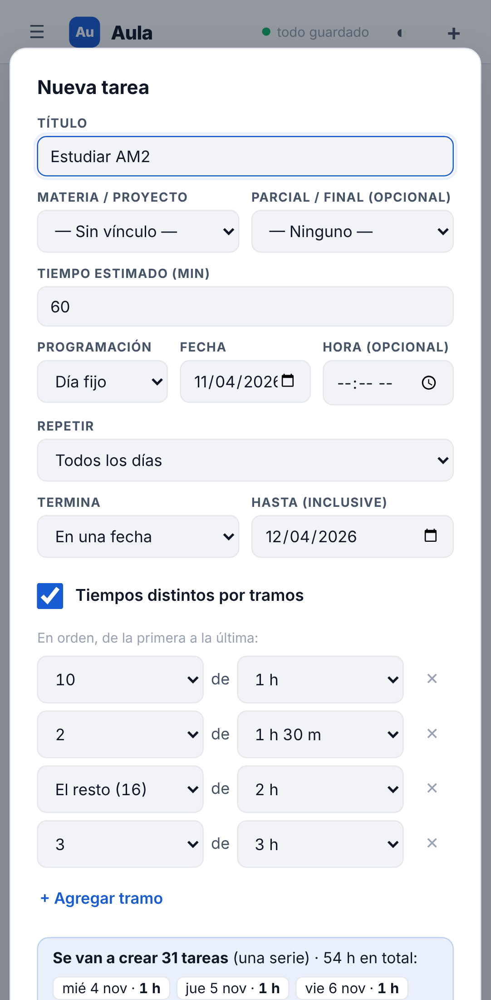
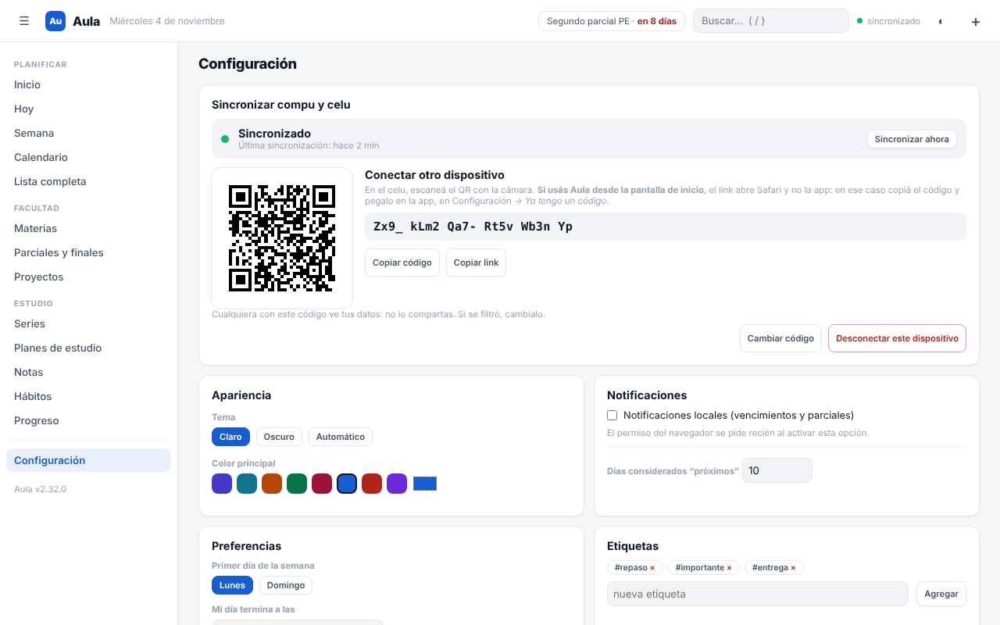
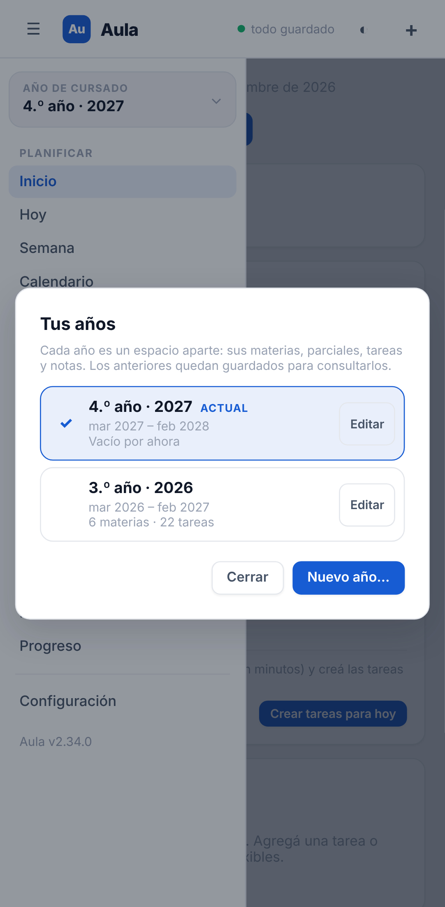

# Resumen de la noche — Aula (jueves 5 de noviembre de 2026)

Buen día, Bauti. Esto es lo que hizo el agente mientras dormías. El detalle de cada decisión está en [`BITACORA.md`](BITACORA.md), y lo que encontró recorriendo la app, en [`AUDITORIA.md`](AUDITORIA.md).

## Qué quedó hecho

- **Series: tiempos por tramos (C4).** Al crear o editar una serie ponés "10 tareas de 1 h · 2 de 1 h 30 · el resto de 2 h" y la vista previa muestra el tiempo de cada una y el total. En el editor: elegir rangos rápido ("primeras N", de la N a la M, arrastrar con el dedo), chips de tiempo de un toque y minutos editables en la misma fila.
- **Arrastrar para ordenar, fluido (C5).** En la compu ya no se traba: se puede agarrar de toda la fila, las demás se corren para hacerle lugar y al soltar se acomoda. En el celu el scroll ya no corta el arrastre.
- **Compu y celu sincronizados (S1).** Con un código (o un QR), sin cuentas. Se fusiona tarea por tarea, lo borrado no revive y sin conexión no se pierde nada. **Falta un paso tuyo en Cloudflare** (abajo).
- **Años de cursado (G1).** Cada año tiene sus materias, parciales y tareas; lo de antes queda en el primer año, igual que estaba. Selector arriba del menú y asistente de "Nuevo año".
- **Tu año en Aula (G2).** Un resumen tipo "Wrapped" en historias a pantalla completa, y cada pantalla se comparte o se guarda como imagen.
- **Parciales el mismo día (L1a).** Si tenés dos o tres el mismo día, se muestran juntos (arriba, en Inicio y en la materia), no solo el primero. Además hay un **revisor automático de textos** que recorre la app en 9 situaciones buscando "undefined", "1 días", "en 0 días", etc.
- **Recorrido pensado (L1b).** Las series dicen hasta cuándo ("hasta el mar 15 dic") y qué día ("todos los sábados"). Una serie "cada mes" el 31 cae el último día de los meses cortos (antes se salteaba noviembre entero). Los bloques de estudio ya no se pisan.
- **Recordatorios (E1a).** "Avisarme" en cada tarea con hora y en cada parcial (los parciales traen 7 días y 1 día antes por defecto, y eso se cambia en Configuración → Avisos por defecto). **Por ahora suenan solo con Aula abierta** y las notificaciones activadas; que lleguen con la app cerrada (ntfy) es lo próximo.

## Qué quedó a medias o sin hacer

- **E1b / E1c (avisos con la app cerrada, vía ntfy):** no llegué. El modelo y la interfaz ya están, así que es "solo" conectar el envío.
- **F1 (pasada de diseño "nivel Apple" en toda la app) y F2 (pasada de calidad como usuario):** pendientes. Tu dirección de diseño (colores, que no quede monocromático tipo Notion) está anotada en el backlog.
- **L1c** (recorrido de Progreso, Configuración, Copias, búsqueda, sync y años): pendiente.
- **H1 (estadísticas con historial):** no se tocó esta noche, como pediste.
- **Un test posiblemente inestable:** en una corrida completa falló una vez `anios.spec.js` por un "404" en consola que no pude reproducir (pasó todas las veces siguientes). Está contado en la bitácora.

## Activar la sincronización (una sola vez, ~2 minutos)

Mientras no lo hagas, la app anda igual que siempre y la tarjeta de Configuración dice "falta activar".

1. Entrá a **dash.cloudflare.com** → **Storage & Databases → KV** → **Create namespace** → nombre `aula-sync` → **Create**.
2. **Workers & Pages** → el proyecto de Aula → **Settings → Bindings** → **Add** → **KV namespace**:
   - **Variable name:** `AULA_KV` (exacto, en mayúsculas)
   - **KV namespace:** `aula-sync`
   - **Save** (si pregunta el entorno: **Production**).
3. **Deployments** → en el último deploy, **⋯ → Retry deployment**. Sin este paso la función no "ve" el KV.
4. **En la compu:** Aula → **Configuración → Sincronizar compu y celu → Activar en este dispositivo**. Arriba tiene que decir **"sincronizado"**.
5. **En el celu:** si usás Aula desde la pantalla de inicio (lo normal), en la compu tocá **Copiar código**, pasalo al celu (portapapeles de Apple o WhatsApp a vos mismo) y en el celu **Configuración → Ya tengo un código** → pegar → **Conectar**. Si usás Aula en Safari, alcanza con escanear el QR.

La primera vez se **suman** los datos de los dos lados (no se borra nada) y antes se guarda una copia automática. Más detalle y qué hacer si los menús de Cloudflare tienen otros nombres: [`SINCRONIZAR.md`](SINCRONIZAR.md).

## Cómo probarlo (en el celu, en este orden)

1. Abrí la app **dos veces** (la primera baja la versión nueva). Abajo del menú lateral tiene que decir **Aula v2.41.0**.
2. **Configuración → Copias de seguridad:** tienen que estar las copias automáticas previas a cada migración de esta noche (`premig-v3`, `v4`, `v5`).
3. **Arriba del menú:** el año de cursado. Todo lo tuyo tiene que estar ahí, igual que ayer.
4. **Creá una serie** de hoy a 30 días con "Tiempos por tramos" y mirá la vista previa con el tiempo de cada una. Después abrila en Series y probá elegir un rango y tocar "1 h 30".
5. **En la compu:** en Hoy, arrastrá una tarea 4 lugares para abajo. Tiene que ir suave.
6. **Abrí un parcial → Avisarme:** 7 días y 1 día antes. Probá agregar "2 h" y quitar uno.
7. **Progreso → Tu año en Aula** (botón arriba a la derecha): pasá las historias tocando y probá "Compartir".
8. **Sincronización:** después del paso de Cloudflare, creá una tarea en la compu y fijate que aparezca en el celu.

## ¿Se publicó? ¿Cómo vuelvo atrás?

- **Publicado en `main`** (se mergeó `agente/mejoras` con todos los tests en verde), así que Cloudflare Pages ya tiene la versión nueva.
- **Si algo no te gusta:** la rama **`antes-del-agente-2026-11-05`** marca cómo estaba `main` antes de esta noche (es una rama y no un tag porque esta sesión no tenía permiso para subir tags; `antes-del-agente`, de anoche, sigue apuntando a antes de la primera noche). Para volver el código: `git checkout main && git reset --hard origin/antes-del-agente-2026-11-05 && git push --force-with-lease origin main` (o pedímelo y lo hago).
- **Tus datos:** antes de cada cambio de forma de los datos, la app guardó sola una copia en **Configuración → Copias de seguridad**. Desde ahí se restaura con un toque.

## Estadísticas de la noche

- **Corridas:** 5 (00:06, 01:06, 02:06, 03:05 y 04:07).
- **Commits:** 26 en `agente/mejoras` desde lo publicado ayer (14 de código, el resto de bitácora, backlog y candado).
- **Versión:** 2.28.0 → 2.41.0. Forma de los datos: esquema 3 → 6, siempre con copia previa y migración probada con tus datos de ejemplo.
- **Tests:** de **196** a **325** que pasan, 0 fallan (31 saltados a propósito: son de un solo dispositivo, compu o celu).

## Las 3 capturas

1. Tiempos por tramos al crear una serie (celu): 
2. Sincronizar compu y celu (Configuración, compu): 
3. Años de cursado: el selector (celu): 
