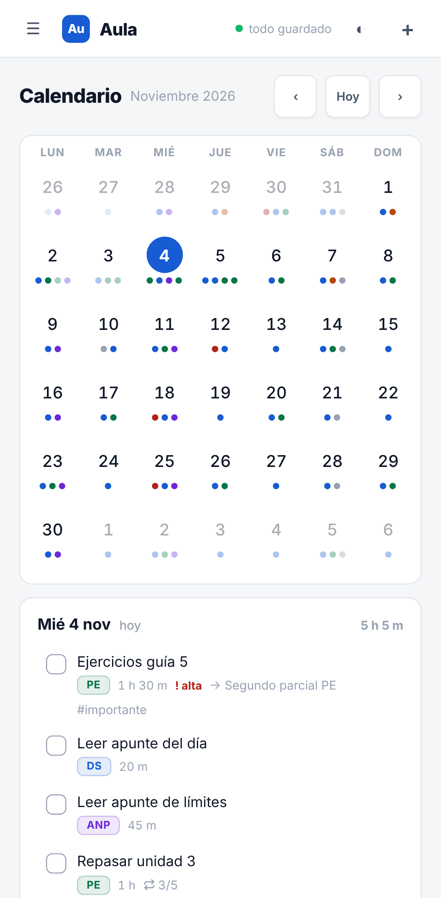
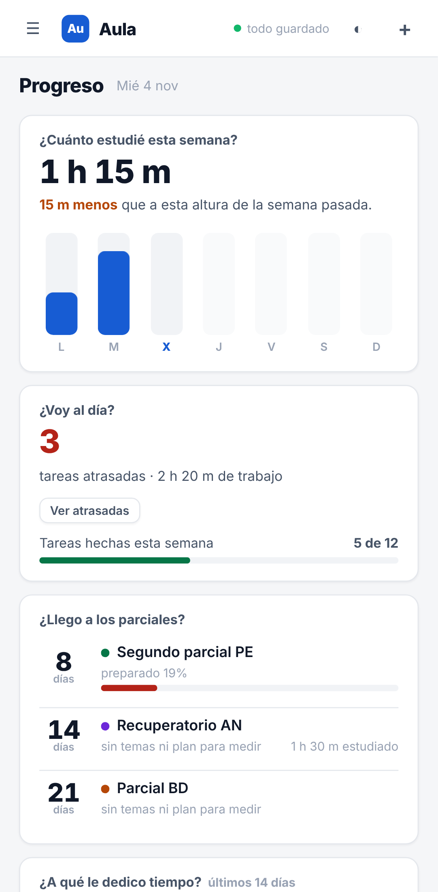
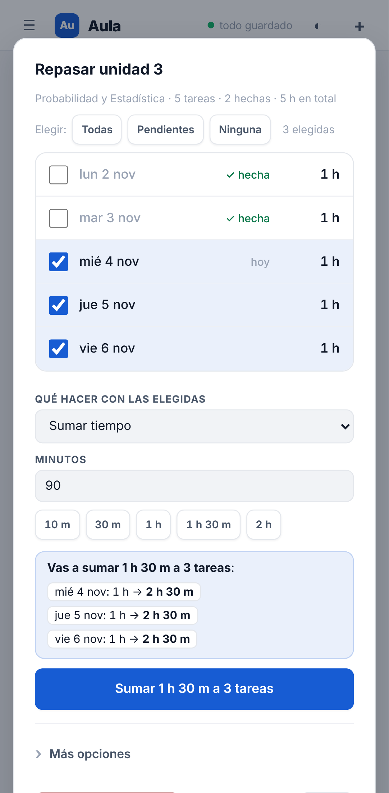

# Resumen de la noche — Aula (miércoles 4 de noviembre de 2026)

Buen día, Bauti. Esto es lo que hizo el agente mientras dormías. El detalle de cada decisión está en [`BITACORA.md`](BITACORA.md).

## Qué quedó hecho

- **Tus datos, protegidos:** antes de cualquier migración la app guarda sola una copia del estado viejo en "Copias de seguridad". Y nada se pierde si cerrás la app justo después de un cambio (A1, X1).
- **"La tarea que hice anoche figura como hecha hoy":** arreglado, respeta a qué hora termina tu día (A2).
- **Una tarea simple ya no aparece como "serie"** (A3).
- **Sin pomodoros**, menú lateral más corto y Configuración ordenada; tus sesiones viejas siguen guardadas (A4).
- **Tareas:** hora en tareas y parciales, comentarios, vínculo tarea → parcial → materia, pasar tareas a otro día fácil (arrastrando o con el dedo) y la lista completa se limpia sola (B1–B5).
- **Series (lo que más te frustraba):** crear repeticiones sin pensar ("cada 3 días × 5", días de la semana, hasta una fecha), editor de la serie con selección y cambios masivos con vista previa y deshacer, editar una sola, agregar y quitar, "3 de 5" y la pregunta "¿solo esta / siguientes / todas?" (C1–C3, X4).
- **Calendario:** en el celu estilo iOS (antes se salía de la pantalla), en la compu horas legibles y + para crear en el día (D1).
- **Progreso:** 5 tarjetas que responden algo (esta semana vs la pasada, ¿voy al día?, ¿llego a los parciales?, tiempo por materia, constancia). Lo viejo, recortado, en "Estadísticas detalladas" (D2).
- **Detalle del parcial** compacto: días que faltan y preparación grandes arriba, botones que no se parten en el celu (X3, X5).
- **Arreglos de última hora:** `sw.js` había quedado vacío por error en la corrida de las 07:06 (sin él la app no anda offline); restaurado y con un test que lo vigila (X6). Y al abrir un editor, el foco ya no se roba lo que estás escribiendo (X7).

## Qué quedó a medias o sin hacer

- **E1 · Notificaciones al celu (ntfy):** no se empezó. Está partido en E1a (modelo + migración), E1b (ntfy) y E1c (respaldo local). En la última corrida decidí no arrancar E1a: toca la forma de tus datos y, sin E1b, mostraría un "Avisarme 30 min antes" que no avisa nada. Mejor hacerlo entero otra noche.
- **F1 (pasada de diseño en toda la app) y F2 (pasada de calidad como usuario):** pendientes. Se fueron puliendo cosas sueltas (X2–X5), pero no se hizo la pasada completa ni la barra de navegación inferior.

## Cómo probarlo (en el celu, en este orden)

1. Abrí la app **dos veces** (la primera baja la versión nueva, 2.28.0; abajo del menú lateral dice la versión).
2. **Configuración → Copias de seguridad:** fijate que esté la copia automática previa a la migración.
3. **Hoy:** una tarea con hora, marcala hecha; abrí una tarea y dejale un comentario.
4. **Creá una serie** ("+", Repetir → cada 3 días, 5 veces). Abrí una de las tareas: arriba dice "3 de 5". Cambiale los minutos y guardá → te pregunta a cuáles aplicar.
5. **Series → tocá la serie:** seleccioná varias, "sumar 30 min", mirá la vista previa y probá Deshacer.
6. **Calendario:** tocá un día con punto rojo (parcial), deslizá para cambiar de mes, "+ Tarea para el …".
7. **Progreso:** ¿las 5 preguntas son las que te hacés?
8. **Un parcial:** mirá el número grande y los botones de "Tareas y plan de estudio".
9. Poné el celu en **modo avión** y abrí la app: tiene que andar (eso es el `sw.js`).

## ¿Se publicó en `main`?

Sí, si `npm test` daba todo verde después del merge (ver al final de este archivo). Si algo no te gusta:

- **Código:** el tag `antes-del-agente` apunta a como estaba `main` antes de esta noche. Para volver: `git checkout main && git reset --hard antes-del-agente && git push --force origin main` (o pedímelo).
- **Datos:** en la app, **Configuración → Copias de seguridad**, restaurá la copia "antes de migrar" que se guardó sola.

## Estadísticas de la noche

- **Corridas:** 5 (04:08, 05:05, 06:06, 07:06, 08:06).
- **Commits:** 35 en `agente/mejoras` (25 de trabajo, el resto candados y cierres).
- **Tests:** de 3 tests de humo (×2 dispositivos = 6) al empezar, a **196 pasando, 0 fallando** al terminar (+16 saltados a propósito: son solo de desktop o solo de mobile).
- **Versión:** 2.6.0 → 2.28.0.

## Tres capturas

| Calendario en el celu | Progreso | Editor de serie |
|---|---|---|
|  |  |  |
